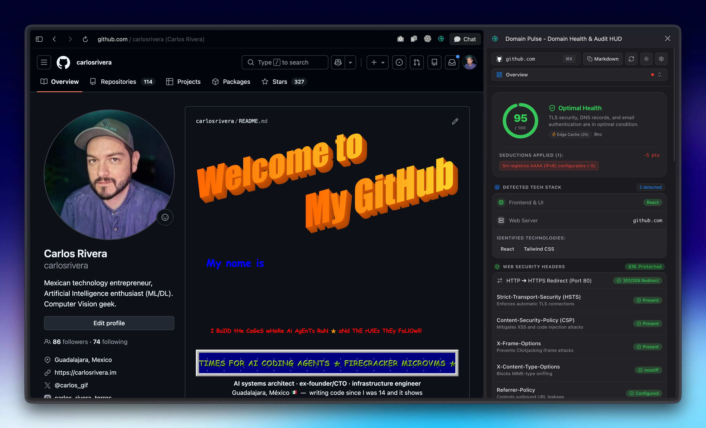

# ⚡ Domain Pulse

> **Inspect DNS, SSL, email security, and web infrastructure in real time from your browser.**

[](LICENSE)
[](https://developer.chrome.com/docs/extensions/mv3/intro/)
[](https://developer.apple.com/documentation/safariservices/safari_web_extensions)
[](https://volcano.dev)
[](https://www.typescriptlang.org/)
[](https://tailwindcss.com/)

---

<p align="center">
  
</p>

---

## 🚀 What is Domain Pulse?

Instead of opening separate tabs for WHOIS lookups, DNS checkers, SSL tests, and email deliverability tools, **Domain Pulse** gives you the full picture directly in your browser's **Side Panel**.

Open the side panel while visiting any site, and Domain Pulse audits its configuration in real time:

- 🌐 **DNS & DNSSEC:** Check `A`, `AAAA`, `MX`, `TXT`, `NS`, `CNAME`, `SOA`, and `CAA` records, along with cryptographic **DNSSEC** chain-of-trust validation.
- 🔒 **SSL/TLS Certificates:** View certificate expiration countdowns, the issuing Certificate Authority (CA), Subject Alternative Names (SANs), TLS 1.3 protocol support, and **HSTS** enforcement.
- 🛡️ **Email Security & Deliverability:** 
  - **SPF Lookup Counter:** Validates your SPF record and counts DNS lookups against the strict 10-lookup limit (RFC 7208).
  - **DMARC:** Checks policy enforcement (`p=reject`, `p=quarantine`, or `p=none`), subdomain rules, and reporting addresses.
  - **MTA-STS & BIMI:** Verifies mail transport security policies and brand indicator trust seals.
- 🔎 **Active Subdomains:** Discovers live subdomains (`admin`, `api`, `mail`, `staging`, etc.) using Certificate Transparency logs, TLS certificates, and DNS probing.
- 💻 **Tech Stack Detection:** Identifies CMS platforms (WordPress, Shopify), web frameworks (Next.js, React, Rails), web servers (Cloudflare, Nginx), and analytics scripts.
- 📊 **Health Score (0–100):** Rates the domain on a simple 0–100 scale, with clear tips on what to fix.
- 📋 **Export to Markdown:** Copy a clean report to your clipboard to paste into GitHub issues, pull requests, or Slack.
- 🌍 **Multilingual:** Automatically matches your browser language, with support for **English**, **Spanish**, **Portuguese**, **French**, **German**, and **Japanese**.

---

## 🏗️ Project Structure

Domain Pulse is built as a TypeScript monorepo using `pnpm`:

```
domain-pulse/
├── packages/
│   └── shared/               # Data types, health score math, and markdown exporter
├── apps/
│   ├── server/               # API Gateway built with Node.js and Hono
│   │   ├── src/services/doh.ts        # Parallel DNS-over-HTTPS queries via Cloudflare
│   │   ├── src/services/subdomains.ts # Certificate Transparency + DNS subdomain discovery
│   │   ├── src/services/rdap.ts       # ICANN RDAP domain registration lookup
│   │   ├── src/services/tls.ts        # Port 443 TLS handshake & certificate inspection
│   │   ├── src/services/http-probe.ts # HTTP security headers & tech stack signatures
│   │   ├── src/services/cache.ts      # In-memory 2-hour cache
│   │   └── src/index.ts               # Local server entry point
│   │
│   ├── extension/            # Chrome Side Panel extension (React 19 + Tailwind v4 + Vite)
│   │   ├── public/manifest.json       # Chrome Manifest V3 configuration
│   │   ├── src/background.ts          # Tab listener and side panel launcher
│   │   └── src/components/            # UI cards (DNS, SSL, Email, Headers, Subdomains)
│   │
│   └── safari/               # Native macOS Safari Web Extension
│       └── DomainPulse/      # Xcode project and Swift host application
│
├── release/                  # Store submission packages and promotional assets
│   ├── domain-pulse-v1.0.1.zip
│   ├── CHROME_STORE_LISTING.md
│   └── PRIVACY_POLICY.md
│
└── volcano/                  # Volcano Cloud serverless deployment files
```

---

## ⚡ Getting Started Locally

### Requirements
- **Node.js** >= 20
- **pnpm** >= 9 (`corepack enable pnpm`)
- **Google Chrome** (v114+ for Side Panel) or **Apple Safari** (macOS)

### 1. Install & Build

```bash
# Clone the repository
git clone https://github.com/maquina-la/domain-pulse.git
cd domain-pulse

# Install dependencies
pnpm install

# Build all packages
pnpm build
```

---

### 2. Run the Local API Server

The API server handles DNS queries, TLS handshakes, RDAP lookups, and HTTP security header inspections:

```bash
pnpm dev:server
```

The server runs on **`http://localhost:3000`**.

Test it in your terminal:
```bash
# Check server health
curl http://localhost:3000/health

# Run an audit
curl "http://localhost:3000/v1/audit?domain=github.com"
```

---

### 3. Load the Extension in Google Chrome

1. Build the extension:
   ```bash
   pnpm build:extension
   ```
2. Open Chrome and go to `chrome://extensions/`.
3. Turn on **Developer mode** in the top-right corner.
4. Click **Load unpacked**.
5. Select this folder from your machine:
   ```
   domain-pulse/apps/extension/dist
   ```
6. Click the **Domain Pulse** icon in your Chrome toolbar. The HUD opens in the Side Panel and inspects your active tab.

---

### 4. Run in Apple Safari (macOS)

1. Build and sign the Safari app:
   ```bash
   pnpm build:safari
   ```
2. Launch the companion app:
   ```bash
   pnpm open:safari
   ```
3. In **Safari**:
   - Go to **Safari > Settings > Advanced** and check **"Show features for web developers"**.
   - In Safari's top menu bar, click **Develop > Allow Unsigned Extensions**.
   - In **Safari > Settings > Extensions**, turn on **DomainPulse Extension**.
4. Click the Domain Pulse icon in Safari's toolbar to open the HUD popover.

---

## 🎯 How the Health Score Works

Each domain starts with **100 points**. Points are deducted for common security and configuration issues:

| Check | Penalty | Why It Matters |
|---|---|---|
| **Invalid or Missing SSL/TLS** | `-40 pts` | Site does not have valid HTTPS or uses an untrusted certificate |
| **Domain Expires in < 30 Days** | `-20 pts` | Imminent risk of domain expiration |
| **SSL Expires in < 14 Days** | `-15 pts` | Certificate needs to be renewed soon |
| **Missing DMARC Policy** | `-15 pts` | Domain is vulnerable to email spoofing and phishing |
| **Missing or Invalid SPF** | `-10 pts` | Senders cannot be verified |
| **DMARC in Monitor Mode (`p=none`)** | `-5 pts` | Policy does not block fraudulent emails |
| **No IPv6 Support (No AAAA Records)** | `-5 pts` | Incomplete modern network support |
| **Missing HSTS Header** | `-5 pts` | Browsers are not forced to connect via HTTPS |
| **Missing CAA Records** | `-5 pts` | Any Certificate Authority can issue certificates for this domain |
| **SPF Exceeds 10 Lookups** | `-5 pts` | Breaks RFC 7208 limits and can cause delivery errors |

---

## 🌋 Cloud API (Volcano)

The backend is deployed to [Volcano Cloud](https://volcano.dev) as a globally distributed Node.js 24 serverless function:

- **Production Endpoint:** `https://7cf17484-33bf-4348-9159-048674bdc509.functions.volcano.run/`
- **Zero Configuration:** The Chrome Web Store release connects to this cloud API automatically with no setup required.
- **Local Fallback:** When developing locally, the extension automatically routes requests to `http://localhost:3000` if your local server is running.

---

## 🔒 Privacy & Security

Domain Pulse does not collect personal information:

- **No accounts or logins:** You never need to sign up or log in.
- **No browsing history:** We only check the hostname of the active tab when you run an audit.
- **Public data only:** All checks use public DNS-over-HTTPS resolvers, public Certificate Transparency logs, and public HTTP response headers.
- **No trackers or ads:** Zero tracking scripts, cookies, or analytics beacons.

Read our complete [Privacy Policy](release/PRIVACY_POLICY.md).

---

## 📄 License

Domain Pulse is open source under the [MIT License](LICENSE).  
Built with ❤️ by [Máquina](https://github.com/maquina-la).
